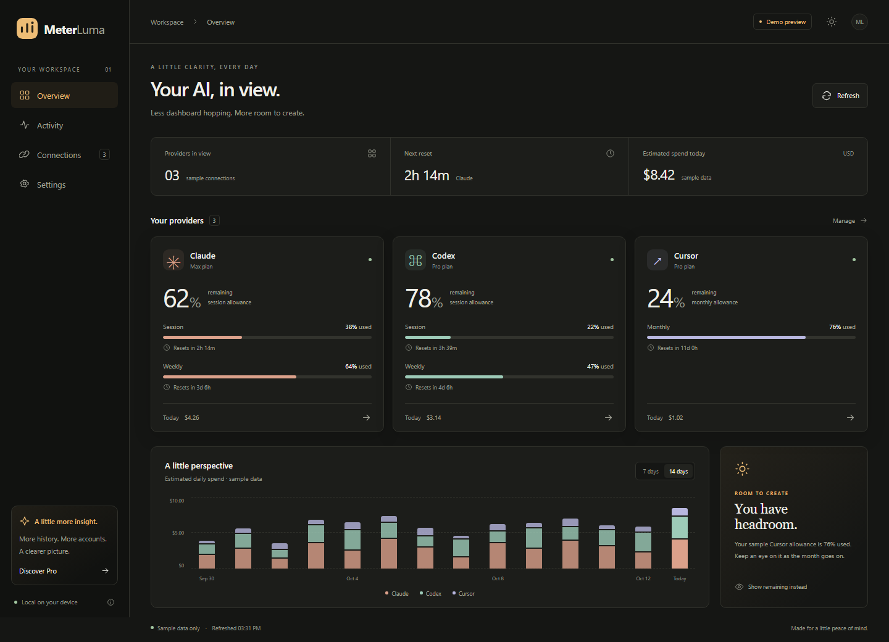

# MeterLuma

All your AI usage, one glance. A desktop tracker for macOS and Windows, with a free core and a planned one-time purchase of MeterLuma Pro.

## Current status

This is an interactive prototype, not a public release. The dashboard, provider visibility, theme preferences, reset countdowns, sample spending charts, and local settings work. Claude, Codex, and Cursor currently display **clearly labeled sample data**. This build does not read provider credentials, connect to accounts, or charge customers.

The Tauri shell includes a tray/menu-bar icon, open/quit actions, a tray summary, single-instance handling, and close-to-tray behavior. Native builds are configured through GitHub Actions for Windows and a universal Intel/Apple Silicon Mac package. Internal artifacts are unsigned.



## Develop

Requires Node.js 22.22 or newer. Install dependencies, then start the browser preview:

```powershell
npm ci
npm run dev
```

Open http://127.0.0.1:1420. Build and verify:

```powershell
npm run build
npx playwright install chromium
npm test
```

For the desktop app, install stable Rust and the OS build prerequisites from the [official Tauri instructions](https://v2.tauri.app/start/prerequisites/). On Windows this includes the Visual Studio C++ build tools and Windows SDK. On macOS this includes Xcode command-line tools.

```powershell
npm run desktop:dev
npm run desktop:build
```

Closing the desktop window keeps MeterLuma running in the tray. Choose **Quit MeterLuma** from its tray menu to exit completely.

## Structure

- `src/`: React dashboard, sample-provider model, charts, local preferences.
- `src-tauri/`: Rust desktop shell, tray behavior, minimal capabilities.
- `tests/`: browser behavior checks at desktop and compact widths.
- `.github/workflows/checks.yml`: interface tests and unsigned native builds.
- `docs/launch.md`: concrete requirements for worldwide release.

The preview stores appearance, provider visibility, and demo preferences in browser/WebView local storage under `meterluma.settings.v1`. It has no analytics, external fonts, billing, account sync, or live provider traffic. Pro descriptions are plans, not delivered functionality. Currency is explicitly USD and sample spend is an estimate, not a subscription charge.

## Ownership and publishing

GitHub home: `youssefrigale/MeterLuma`. Keep the repository private until the implementation, licensing, and release materials are ready for owner review. Free pricing does not imply an open-source license; the owner still needs to choose the source licensing terms.
