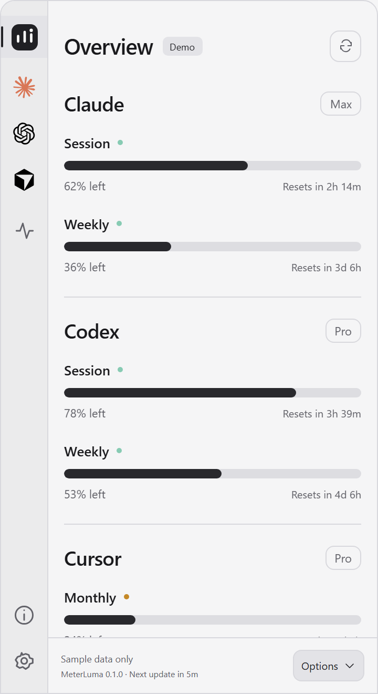
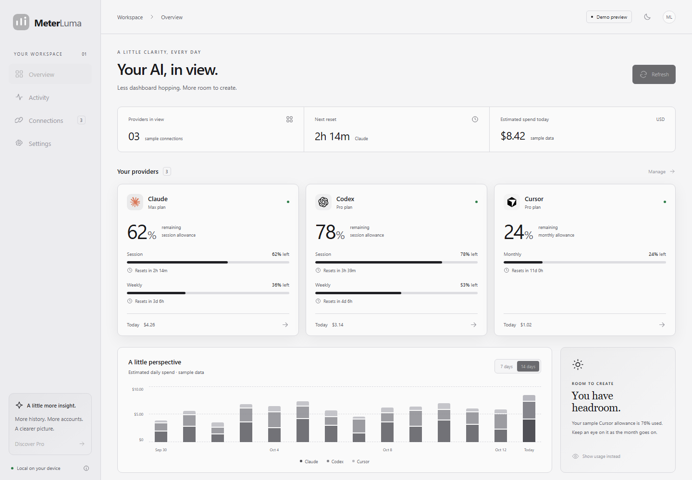

# MeterLuma

All your AI usage, one glance. A desktop tracker for macOS and Windows, with a free core and a planned one-time purchase of MeterLuma Pro.

## Current status

This is an internal prototype, not a public release. The dashboard, provider visibility, theme preferences, reset countdowns, sample spending charts, and local settings work. It starts with **clearly labeled sample data** and also includes experimental native connections for Claude Code, Codex CLI, and Cursor. Those connections need real-account QA before release. Pro and checkout are not implemented.

In the desktop app, open Connections and select **Connection options**, then **Use local sign-in**. This is the point where MeterLuma reads that provider's existing local credential. Browser preview mode cannot access native credentials or fetch live limits. Live and sample spending are never mixed.

The primary desktop interface is a compact popup with a vertical icon sidebar: overview, individual provider details, costs, help, and settings. Provider pages show allowance bars, reset times, spending summaries, sample trends, and an explicitly illustrative model mix. Live history, token counts, and model breakdowns remain unavailable. Settings work inside the popup: refresh every 5 / 15 / 30 / 60 minutes, Left / Used bars, relative / absolute reset timers, clock format, appearance, and provider visibility and order. Provider website buttons open fixed status and usage pages in the default browser. Additional integrations, global shortcuts, and startup at login are not implemented.

The popup is 360 logical pixels wide and changes height with the page (420–660 pixels), with scrolling content and a fixed Options footer. It starts hidden in the tray; clicking outside hides it. Light gray and black is the default appearance, with a neutral graphite dark variant. Claude, OpenAI, and Cursor use their actual provider logo assets in the popup and dashboard. Preferences synchronize with the optional full dashboard. Windows accounts for actual client and visible-frame margins so the bottom edge docks flush against the taskbar, including after resizing; macOS retains menu-bar positioning and accessory activation. Native Windows and universal Mac packages are built through GitHub Actions. Internal artifacts are unsigned.



Cost ranges in the demo are simulated, including the thirty-day sample. Live mode currently displays real plan limits only, with an explicit unavailable-cost state instead of fabricated spending.



## Develop

Requires Node.js 22.22 or newer. Install dependencies, then start the browser preview:

```powershell
npm ci
npm run dev
```

Open http://127.0.0.1:1420. Build and verify:

```powershell
npm run build
npx playwright install chromium
npm test
```

Optional WebKit coverage, closer to the Mac renderer:

```powershell
npx playwright install webkit
npm run test:webkit
```

For the desktop app, install stable Rust and the OS build prerequisites from the [official Tauri instructions](https://v2.tauri.app/start/prerequisites/). On Windows this includes the Visual Studio C++ build tools and Windows SDK. On macOS this includes Xcode command-line tools.

```powershell
npm run desktop:dev
npm run desktop:build
```

Closing the desktop window keeps MeterLuma running in the tray. Choose **Quit MeterLuma** from its tray menu to exit completely.

## Structure

- `src/`: React dashboard, sample-provider model, charts, local preferences.
- `src-tauri/`: Rust desktop shell, tray behavior, native credential readers, provider HTTP clients and response mappers.
- `tests/`: browser behavior checks at desktop and compact widths.
- `.github/workflows/checks.yml`: interface tests and unsigned native builds.
- `docs/launch.md`: concrete requirements for worldwide release.

The app stores appearance, provider visibility, demo preferences, and selected connection IDs in browser/WebView local storage under `meterluma.settings.v1`. It never copies credentials there. There are no analytics, external fonts, billing, or account-sync servers. Pro descriptions are plans, not delivered functionality. Sample spend is an estimate in USD, not a subscription charge; live spending history is not yet implemented.

## Experimental live providers

- Claude Code: `.claude/.credentials.json` (or `CLAUDE_CONFIG_DIR`), plus the default `Claude Code-credentials` Keychain entry on macOS. Reads session and weekly usage. Claude Desktop-only sign-ins are not supported yet.
- Codex CLI: `.codex/auth.json` (or `CODEX_HOME`) with a ChatGPT OAuth token. API-key-only and keyring-only configurations are not yet supported. Reads primary and secondary rate-limit windows.
- Cursor: read-only local `state.vscdb` in the OS app-data directory, with macOS Keychain fallback. Reads the current period's supported plan limits.

Credentials stay inside the native process and are sent only to that provider's fixed HTTPS endpoint. Redirects are disabled. Responses are bounded to 1 MiB, errors never include raw response bodies or token values, and cached results are keyed by a credential/account fingerprint. Usage requests are cached for five minutes. Expired credentials must be renewed in the provider app; MeterLuma never rotates or overwrites them. A sign-in change during a request discards that response.

These provider endpoints are external dependencies and can change. Unsupported response shapes show an error instead of invented usage. Actual subscription/enterprise plan variants and platform credential formats still require native validation before launch.

## Ownership and publishing

GitHub home: `youssefrigale/MeterLuma`. Keep the repository private until the implementation, licensing, and release materials are ready for owner review. Free pricing does not imply an open-source license; the owner still needs to choose the source licensing terms.

## Verified beta checkpoint — 2026-10-13

- Runtime commit: `6e556288175f6ec8491c3950a7876b94ca626b84`.
- [Native and interface build run](https://github.com/youssefrigale/MeterLuma/actions/runs/38479038508): successful Windows x64 and universal Mac packages; 15 native tests on each platform, including provider response handling, taskbar/frame geometry, and rejection of arbitrary provider URLs; 38 Chromium interface checks.
- Local WebKit verification: all 19 checks passed, including provider details, popup settings, saved ordering, both themes, and sidebar accessibility.
- Ten actual Windows WebView2 integration checks passed: hidden startup, single-instance opening, initial and reopened taskbar alignment, overview sizing, popup Settings, isolated provider views, page resizing, alignment after each resize, dashboard handoff, and theme synchronization. Heights of 420, 520, 620, and 660 logical pixels all retained a **0-pixel visible-frame taskbar gap**. See `artifacts/native-panel-check.json`, `artifacts/quick-view-windows-native.png`, and `artifacts/quick-view-provider-windows-native.png`.
- The new portable executable was verified against its build artifact and relaunched normally. Its MeterLuma quick-view window appeared and responded. Windows and Mac builds retained identical committed `Cargo.lock` files; SHA-256 checksums were generated for all local release packages.
- Antigravity and other additional connectors, live spending/token/model history, shortcuts, startup at login, real provider-account validation, Mac GUI testing, signing, updater, Pro, licensing, and checkout remain unimplemented or unverified. This checkpoint is not a public-release approval.
