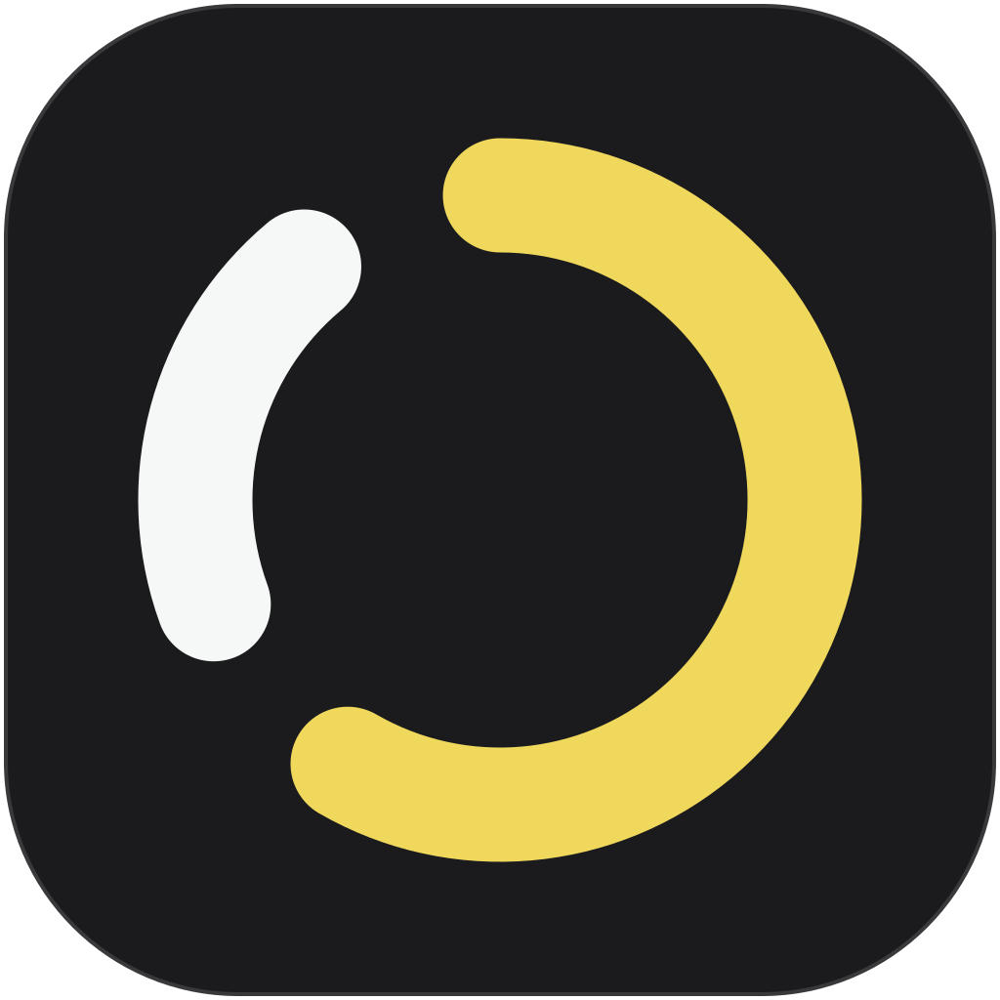
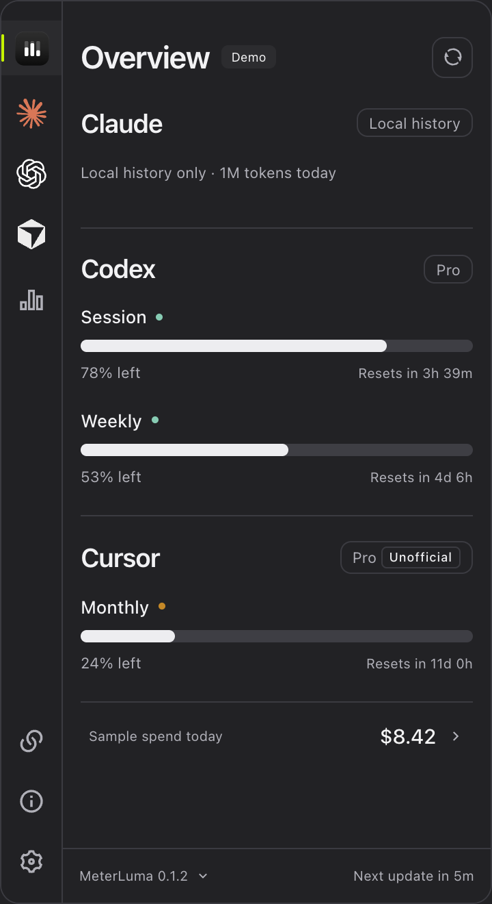

<p align="center">
  
</p>

<h1 align="center">MeterLuma</h1>

<p align="center"><strong>All your AI usage, one glance.</strong><br>
A menu-bar and system-tray companion for Claude Code, Codex and Cursor.</p>

<p align="center">
  macOS & Windows · Version 0.1.2 pre-release · Free for personal use
</p>

<p align="center">
  <a href="#features">Features</a> ·
  <a href="#supported-providers">Providers</a> ·
  <a href="#run-locally">Run locally</a> ·
  <a href="PRIVACY.md">Privacy</a> ·
  <a href="LICENSE">License</a>
</p>

MeterLuma brings usage limits, reset times and recorded token activity into a compact desktop popup. Use your existing local provider connections, check your allowance, and get back to work.

**Project status:** this is a pre-release source repository. No public installer release is published yet. Local builds are available for development and testing; signing, installer validation and platform QA remain release work.

<p align="center">
  
  <br><sub>Development preview of the published source. All displayed values are sample data.</sub>
</p>

## Features

- **Usage at a glance.** See remaining or used allowance and reset times when a provider supplies them.
- **Existing local connections.** Detect Claude Code history, a signed-in Codex CLI and Cursor desktop profiles after the connection notice. No separate MeterLuma account is required.
- **Recorded activity.** Explore 30, 90 or 365 days of available Claude Code and Codex history, token trends and model breakdowns.
- **Multiple profiles.** Keep supported local profile folders separate and give them readable labels.
- **Quota alerts.** Set in-app usage thresholds for live Codex and Cursor allowances.
- **Local exports.** Save recorded usage as CSV or JSON through the system save dialog.
- **Your display preferences.** Choose light, dark or system appearance, allowance direction, reset-time format and refresh interval.

## Supported providers

This table describes the source currently published on `main`.

| Provider | Usage limits | Recorded history | Connection |
| --- | --- | --- | --- |
| **Claude Code** | Not available in this published snapshot | Local token counts, models and daily activity | Existing Claude Code logs |
| **Codex** | Subscription allowances, resets and returned plan/credit details | Local CLI session logs | Signed-in official Codex CLI; optional advanced account token |
| **Cursor** | Monthly allowance through an unofficial endpoint | Not available | Existing desktop sign-in; optional advanced account token |

Provider data can be unavailable, expired or rate limited. Cached results retain their original fetch time. Cursor's undocumented endpoint may change independently of MeterLuma.

History covers logs that still exist on the selected device and profile. Missing days are marked **Not recorded**. Local history and saved plan labels do not establish whether a subscription is active, paused or paid.

The Costs view estimates the API-equivalent value of recorded tokens using the bundled price table. **These estimates are not your subscription bill or actual provider charges.**

## Privacy

MeterLuma has no analytics, advertising, publisher account service or cloud sync. Recorded usage and conversation content are not uploaded to a MeterLuma server.

- Local logs are processed on your device for usage metadata.
- Provider requests run in the native app. Credentials are sent only to the relevant provider endpoint or handled by its installed CLI.
- Optional account tokens use macOS Keychain or Windows account-bound DPAPI storage, rather than WebView preferences.
- Exports omit credentials, profile directory paths and conversation content.
- Disconnecting in MeterLuma does not sign you out of the provider or delete its original logs.

Read the full [privacy information](PRIVACY.md) before connecting a provider. Keep tokens and unredacted usage exports out of issues and screenshots.

## Run locally

Install **Node.js 22.22 or newer**, **stable Rust**, and the [Tauri 2 prerequisites](https://v2.tauri.app/start/prerequisites/) for your operating system. Desktop builds require the Xcode command-line tools on macOS, or the MSVC C++ build tools and Windows SDK on Windows. The macOS deployment target is 13.0 or newer.

```sh
git clone https://github.com/youssefrigale/MeterLuma.git
cd MeterLuma
npm ci
npm run desktop:dev
```

The desktop app starts in the menu bar or system tray. Click its icon and open **Connections** to choose a provider. If Codex limits are unavailable, check that the official Codex CLI is installed and signed in. If a local profile is not detected, select its supported folder under **Multiple local accounts**.

For a browser-only development preview:

```sh
npm run dev
```

Open `http://127.0.0.1:1420`. Browser previews cannot read native provider connections; sample data is available only in development.

### Build and check

```sh
npm run build
cargo test --manifest-path src-tauri/Cargo.toml --lib
npx playwright install chromium webkit
npm test
npm run test:webkit
npm run test:release
```

Build the desktop application for the current operating system:

```sh
npm run desktop:build
```

Windows builds are unsigned. macOS distribution requires Developer ID signing and notarization. See the [release process](docs/release-process.md) for packaging and updater configuration.

## Documentation

- [Privacy and local data handling](PRIVACY.md)
- [Changelog](CHANGELOG.md)
- [Build and release process](docs/release-process.md)
- [Beta testing](docs/beta-testing.md)
- [Third-party notices](THIRD_PARTY_NOTICES.txt)

Report reproducible bugs through [GitHub Issues](https://github.com/youssefrigale/MeterLuma/issues), including your operating system, app version and steps to reproduce. For a possible credential exposure, do not post the credential publicly.

## License and attribution

MeterLuma is **source available**, under the [MeterLuma Personal Use License 1.1](LICENSE). Personal, noncommercial use and private modification are permitted. Commercial use, sale and redistribution require separate permission. Making the repository public does not change those terms.

Third-party components retain their own licenses. Claude, Codex and Cursor names and logos belong to their respective owners and identify those services only. MeterLuma is not affiliated with or endorsed by Anthropic, OpenAI or Anysphere.
